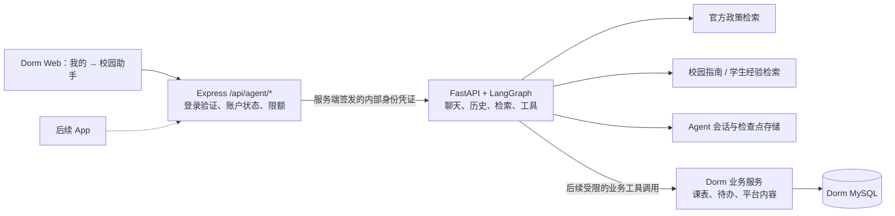

# Campus Copilot 接入 XMUMDorm：Web 模块与知识库扩展研究

研究日期：2026-10-23。用户已确认：**先接 Web，之后复用到 App**。

本轮核查对象是 `E:\Campus Copilot` 和 `C:\Users\阴沛森\Desktop\XMUMDorm-2.0.0-LYZZ` 的当前工作区。结论来自代码阅读与官方协议文档；没有启动集成服务、调用付费模型、构建索引或部署。本文中的新增接口、文件名和阶段均为建议，尚未实现。

## 结论

推荐把 Campus Copilot 作为 **XMUMDorm 的独立 Python Agent 服务**：Web 页面融入 Dorm，登录和业务权限由 Dorm Express 统一处理，Python 继续负责模型、工具调用、检索与对话状态。

现有 Agent 已具备复用所需的核心能力，但不能直接把页面或接口地址复制过去。必须完成身份桥接、流式协议接入、工具数据源调整，以及运行环境的持久化配置。首版建议提供政策问答、校园指南问答和会话历史；真实课表、待办等能力随后通过 Dorm API 接入。

扩展知识库主要是 **增加可追溯资料、完善导入与检索**，首版不需要模型微调。应分清三类信息：官方政策用政策检索，学生经验用独立的指南检索，个人及实时业务数据用受权限控制的工具查询。

## 1. 两个项目的接缝

| 方面 | 当前 Campus Copilot | 当前 XMUMDorm | 接入要求 |
| --- | --- | --- | --- |
| 后端 | Python / FastAPI / LangChain / LangGraph | Node.js / Express / MySQL | 保留两个进程，用 HTTP 连接 |
| Web | 原生 HTML / JS | React / Vite / React Router | 复用聊天协议，在 Dorm 实现 React 页面 |
| 登录 | 随机 token，数据库存其哈希，身份是用户名 | JWT，身份是数值 `users.id`，中间件复查账户状态 | 加服务端身份桥接，不要求二次注册 |
| 对话 | POST SSE、多会话、历史、人工确认 | 通用请求封装按 JSON / 文本完整读取 | 增加流式请求函数和事件解析 |
| 业务数据 | 公共 SQLite 演示数据、用户手工录入数据 | MySQL 中的真实平台业务记录 | 接业务工具时使用 Dorm 已有权限与数据语义 |
| 知识 | Markdown → Embedding → Milvus / Chroma | 新生指南、课程评价、学习资料等 | 按来源信任程度与可见权限接入 |

依据：[Campus 架构](./architecture.md)、[Agent 组装](../src/agent/assistant.py)、[Campus 鉴权](../src/auth.py)、[Dorm 目标代码研究](./research-xmumdorm-target-2026-10-23.md)。Dorm 的名称不表示已存在报修、宿舍分配或水电账单模块；本方案不把这些假定为现有能力。

## 2. 推荐接入形态



### Web 入口

建议先在“我的 → 工具”增加“校园助手”，页面地址设为 `/myzone/agent`，复用现有 Shell、AuthGuard 和设计令牌。代码落点是 `frontend/src/pages/MyZone.jsx`、`frontend/src/routes/layoutRoutes.jsx`，新增页面可放 `frontend/src/pages/Agent/`。是否升级为全站导航入口，可以在使用验证后决定。[目标研究：Web 入口](./research-xmumdorm-target-2026-10-23.md)

注意现有 `AuthGuard` 也放行选择“暂不登录”的访客。首版聊天仍应要求真实登录，并在 Express 接口独立校验，不能只依赖页面守卫。

Campus 现有页面可作为交互参考；不建议 iframe 嵌入：当前 FastAPI 明确返回 `X-Frame-Options: DENY`，且 iframe 本身不能解决账户和页面风格整合。[`src/server.py:108`](../src/server.py)

### 身份桥接

建议请求链如下：

1. 浏览器沿用 Dorm token，向 Express `/api/agent/*` 发请求。
2. Express 使用现有 `authenticateToken` 验证 JWT 并检查账户状态，再执行 Agent 模块的权限和限额检查。
3. Express 签发短期内部凭证，只在服务之间传递。建议携带固定 `iss`、`aud`、稳定 `sub`、签发与过期时间；凭证使用独立签名配置，不直接复用 Dorm 登录密钥。
4. FastAPI 新增内部鉴权入口，验证签名、算法、签发方、接收方和时效，然后构造 `UserContext`。用户标识建议规范为 `xmumdorm:<users.id>`，与原本本地账号分开。
5. 所有会话查询、创建、恢复请求都使用同样的服务端身份；继续校验会话归属与检查点版本。

不把用户提供的 `user_id`、昵称、学号当作可信身份。浏览器传来的内部身份头必须由 Express 丢弃并重建。原始 Dorm 登录 token 不进入模型提示词、画像或工具结果。

现有会话/历史存储按文本 `user_id` 隔离，因此接入身份有可复用基础；新标识仍需通过跨账号隔离测试，不能仅修改字符串后就宣布兼容。现有 Campus 会话不会自动归属于 Dorm 账号，首版可从新身份开始，旧数据迁移单独处理。[`src/context.py`](../src/context.py)、[`src/conversations.py:11`](../src/conversations.py)、[`src/chat_history.py:13`](../src/chat_history.py)

### API 与流式输出

| 建议的 Dorm 接口 | 对应 Agent 能力 | 响应 |
| --- | --- | --- |
| `GET /api/agent/conversations` | 列出本人会话 | JSON |
| `POST /api/agent/conversations` | 新建本人会话 | JSON |
| `GET /api/agent/conversations/:id` | 历史、运行状态、待确认动作 | JSON |
| `POST /api/agent/chat` | 提问或恢复确认动作 | SSE |

保留现有聊天请求中的 `message` / `resume` / `decisions` 三选一约束，以及 `conversation_id`、`checkpoint_id` 语义。`semester_id` 仅在学期相关功能需要时传入。

现有 SSE 使用 `data: {"type":"token", ...}`，类型在 JSON 的 `type` 字段中，并非依赖命名 `event:` 帧。前端应处理 `token`、`interrupt`、`limit`、`done`、`error`，正确处理中文跨网络块拆分、心跳和残帧。

在 `shared/api/` 增加 Agent API 与流读取能力，共用既有 token / base URL 注入机制。普通 JSON 接口可沿用请求封装并统一错误格式；聊天流必须绕过整段 `res.json()` / `res.text()`。Express 需要持续转发、处理背压，不能先收完整答案再返回。

首版可以使用 Fetch POST + 流读取，不需要增加 WebSocket。当前服务断开传输后仍继续推理并落库，因此页面应显示“连接中断，可恢复会话”；自动恢复应 GET 状态，不能自动重发 POST。原生 App 将来复用接口契约，流读取实现仍须在真实设备验证。[协议研究与官方依据](./research-agent-protocol-2026-10-23.md)

### 服务与数据部署

本地验证先让 Express 访问回环地址上的 Python 单进程。线上部署需要新增常驻 Python 服务、持久化目录或数据库、模型配置、内部网络访问规则以及流式超时配置。Campus 当前 README 的“本机原型”不是可直接上线的承诺。

- Agent 初版保持单进程/单实例；`RunRegistry` 是进程内锁，多 worker 不能靠数据库检查点自动获得同会话互斥。横向扩容前再补分布式执行协调。
- 保留 Dorm MySQL 为业务事实来源；Agent 会话可继续独立使用支持的 PostgreSQL / SQLite，不必为接入强行移植 LangGraph 存储到 MySQL。
- SQLite / Chroma 用于本地联调最省事；线上若继续使用文件存储，必须有持久卷与备份。索引发布登记和向量数据需要一起保存。
- Vite 开发配置已将 `/api` 转发到 Express；生产 Web 的 `vercel.json` 只有 SPA rewrite，不能据此认定生产同源 API 已配置。应核对现有 `VITE_API_BASE_URL` 和部署链路，再决定代理地址。
- 为 Agent 加按用户的调用/并发限额和全局并发上限。现有按会话限额可通过新建会话重置，不能代替总成本限制。

依据：[`src/agent/web_runs.py`](../src/agent/web_runs.py)、[`src/agent/middleware.py:195`](../src/agent/middleware.py)、[存储说明](./storage.md)、[目标部署证据](./research-xmumdorm-target-2026-10-23.md)。本轮未核验任何线上部署状态。

## 3. 知识库怎么扩展

### 按数据性质选择接法

| 内容 | 推荐接法 | 回答中必须保留的信息 |
| --- | --- | --- |
| 学校官方规定、宿舍管理规则、办理指南 | 官方政策 RAG | 原文出处、适用时间、版本、人工整理或原文摘录标记 |
| SurviveXMUM、Dorm 新生指南、学生经验 | 新增 `search_campus_guide` 等社区知识检索工具 | 学生/社区来源、更新时间、原文链接；不得当作校方规定 |
| 选课评价 | 复用已有经验查询逻辑，或接 Dorm 已有评价服务 | 不同评价与出处，不把评价包装为官方标准 |
| 我的课表、待办、订单状态等 | 通过 Dorm 权限控制的结构化工具 API | 当前用户、查询时点、学期或业务范围 |
| PDF / DOCX / HTML | 先做格式转换与来源校验，再进入相应知识类型 | 原文位置、文档版本；扫描 PDF 另需 OCR |

Agent 不应直接读取整个 Dorm 数据库。个人课表应由可信身份调用对应业务服务；工具参数可以包含日期、学期等查询条件，不能让模型任意指定他人身份。动态数据不适合通过全库向量化来保持实时性。

### 当前实现已经支持什么

`scripts/build_kb.py` 已有以下链路：读取 Markdown 的单行 front matter → 按标题切分 → 300 字符块/80 字符重叠 → Embedding → 候选索引校验 → 发布指针切换，失败保留原版本，并支持回滚。

官方资料扩展可以先按现有格式添加到 `data/raw_docs/` 顶层，补齐 `title`、`source`、`doc_type`、`lang`、`source_type`、`collected_at`、`effective_date`。只使用真实核验的日期；采集日不能冒充生效日。`official_excerpt` 与 `manual_summary` 必须按内容实际性质选择。

已有命令如下，**本轮未执行**：

```powershell
python scripts/build_kb.py --status
python scripts/build_kb.py --stage-only
# 从输出取得候选 GENERATION 和状态中的 revision 后，完成候选验收再发布：
python scripts/build_kb.py --publish GENERATION --expected-revision N
# 如需回退，先重新查询当前 revision，再使用该值：
python scripts/build_kb.py --rollback --expected-revision N
```

`--stage-only` 会实际调用 Embedding 并写候选索引。构建自检验证数量与样本文本召回，不等于业务问答正确；需要另做代表问题评测。默认无参数执行会构建并自动发布。[`scripts/build_kb.py:63`](../scripts/build_kb.py)、[`src/kb.py:143`](../src/kb.py)

目前 `search_policy` 只检索 active 版本，不能直接指定未发布候选。实施时应增加只读的候选 generation 评测入口，再落实上述“评测后发布”流程；不能把现有构建自检当作完整验收。

### 当前需要补齐的部分

1. **输入范围**：加载器只扫描 `data/raw_docs/*.md`，不递归、不直接读 PDF / DOCX / JSONL，也不会自动读取已爬取的 Wiki 快照。
2. **社区知识通道**：政策门槛只接受 `manual_summary` / `official_excerpt` 和允许的官方域名。Wiki 的 `student_wiki` 既不在现有证据类型中，也不应通过改名伪装成官方资料。
3. **多知识域**：保留政策门槛，新增社区证据类型与检索入口；若采用独立 collection，需同步扩展发布登记和读取路由，不能仅修改集合名。
4. **同步与删除**：按稳定来源 ID、版本和内容哈希识别变化；只发布完整快照。文章被隐藏或删除时要撤回检索结果，公共知识中不包含草稿和个人内容。
5. **检索质量**：新增生活/宿舍类别时调整工具参数枚举、关键词和提示词；先用真实问题验证当前分块，再决定是否调整块大小、关键词检索或重排。
6. **时效与可见性**：元数据增加版本、适用期、来源种类、可见范围和撤回状态还不够，查询时也要执行相应过滤。Dorm 的 `published` 只表示可见，不证明经过审核或来自学校。

其中第 6 点有实际代码依据：Dorm 指南允许普通用户发布，来源名称和链接也可由投稿者填写；这些内容适合作为社区资料，不能仅凭发布状态升级为官方政策。[知识库详细研究](./research-kb-expansion-2026-10-23.md)、[Dorm 内容来源研究](./research-xmumdorm-target-2026-10-23.md)

### Wiki 与 Dorm 指南的建议导入流程

```text
公开资料 / 已发布指南
  → 保存原始快照与来源信息
  → 检查快照完整性、可见状态、来源类型
  → 规范化标题、正文、原文链接、时间、版本、内容哈希
  → 分块并建立候选索引
  → 评测检索、引用、时效与拒答
  → 发布
  → 后续同步修改、隐藏和删除
```

SurviveXMUM 已有采集脚本与 JSONL 快照格式，可复用采集成果，新增规范化适配器即可开始后续工作；现有脚本的代理要求应保留。本轮不需要重新爬取。[采集说明](./survivexmum.md)

## 4. 建议的实施顺序与验收

| 阶段 | 具体产出 | 完成标志 |
| --- | --- | --- |
| 1. 接通 Web | React 聊天页、Express 网关、内部身份验证、历史接口、SSE | Dorm 一次登录即可聊天；两个用户的历史隔离；刷新能恢复；鉴权错误和服务不可用可见 |
| 2. 扩展知识 | 官方资料更新、Wiki/指南适配器、独立社区检索、候选评测 | 能区分官方与经验；每条事实可追溯；未知/过期资料不冒充现行规定；失败构建不影响线上索引 |
| 3. 接真实工具 | 优先接我的课表、待办读取；替换相应演示数据能力 | 数据来自 Dorm 当前账号；他人数据不可查；没有数据时明确告知 |
| 4. 扩到 App / 写操作 | 共用 API 契约、App 流读取验证；按需求增加操作工具 | 真机断线恢复正常；写操作具有权限校验、确认与幂等机制 |

首版优先让 `search_policy`、新增指南工具以及所需会话能力可用。不要默认开放全部 12 个现有工具；`get_agent(tools=...)` 已支持工具子集，但提示词目前仍固定列出全部路由，须同步按启用能力生成提示词，避免诱导调用未挂载工具。[`src/agent/assistant.py:47`](../src/agent/assistant.py)、[`src/prompts/system.py:32`](../src/prompts/system.py)

关键验证包括：伪造身份和跨用户会话访问、注销账户访问、过期检查点、中文流分块、模型错误、断线后状态恢复、重复发送、第三方资料伪装政策、隐藏内容撤回和索引回滚。真实模型评测与离线接口测试分开记录，不沿用历史测试数字作为本次结果。

## 5. 本轮交付与尚未验证的事项

- [目标项目与改动位置](./research-xmumdorm-target-2026-10-23.md)
- [知识库格式、扩展限制与发布机制](./research-kb-expansion-2026-10-23.md)
- [流式协议、代理与持久化语义](./research-agent-protocol-2026-10-23.md)

本轮只新增研究文档，没有修改两个项目的业务代码。目标生产拓扑、现有数据库数据完整度、模型成本与并发容量、资料当前有效性，以及 App 真机流读取能力均未实测；这些分别由实施联调、资料校验和部署验证解决。
